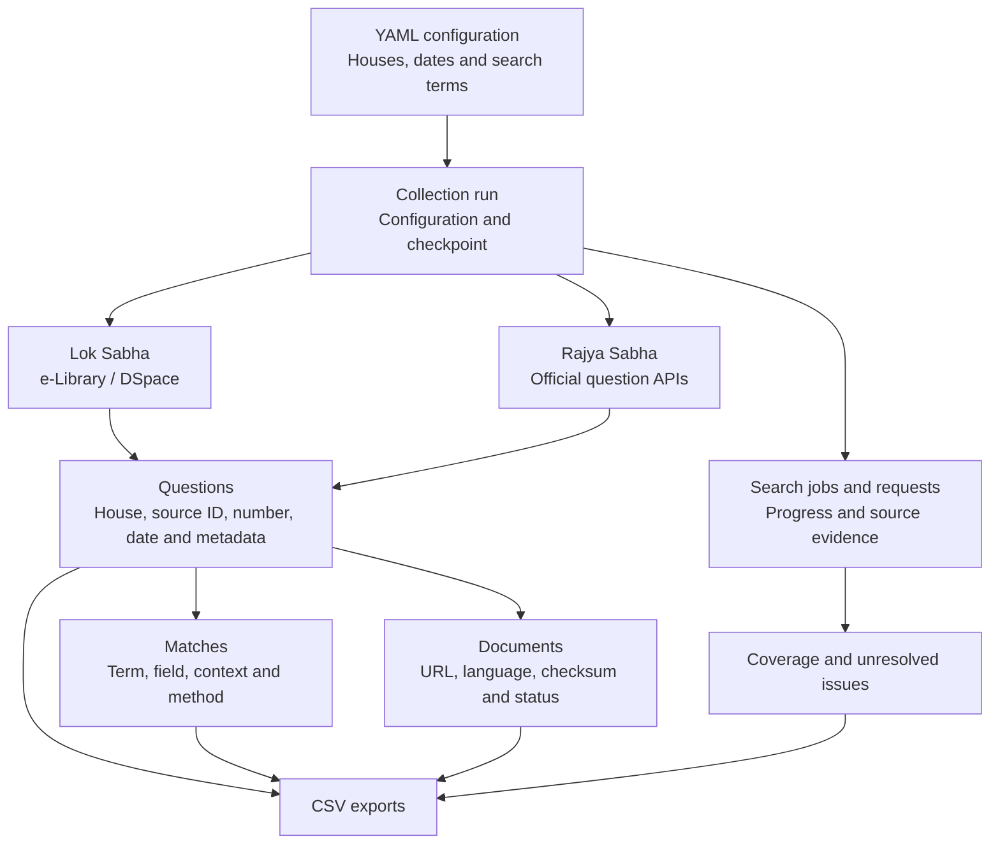

# Data model and sources

The checkpoint is SQLite. `questions` stores a house-prefixed source key and source payload; `matches` links terms and fields to questions; `documents` links original URLs and downloaded files to questions; `jobs` records each search partition and page; `requests` records source response provenance; and `issues` records unresolved problems. `run` stores the resolved configuration and hash. CSV exports are generated from these tables without requiring a network connection.

## Data model

This diagram shows the collection's logical flow. In the checkpoint, each match and document record refers to one question; a question can have several matches and documents. The same source document can appear in more than one question association. Jobs, requests and issues record progress and evidence; the arrows do not imply additional database foreign keys.

Question metadata includes House, parliamentary term if provided, session, date, question number, type, title, members, ministry, question/answer text, text source and official links. Missing fields are empty, not invented. Question keys use the House plus DSpace item UUID for LS or the internal `qslno` for RS. Neither is the parliamentary question number. Exact, independently reconciled migrated RS IDs are retained in `alternate_source_ids`. A single document may appear in multiple question associations; its source URL and hash expose shared originals. Automatic cross-language version linking is not attempted without sufficient evidence.

## Lok Sabha

The official [e-Library DSpace search API](https://elibrary.sansad.in/server/api/discover/search/objects) is queried by term and year. Collection scope `75228d43-3a98-4b7d-b90f-ffec6aa9fa11` was checked against the [official collection record](https://elibrary.sansad.in/server/api/core/collections/75228d43-3a98-4b7d-b90f-ffec6aa9fa11): it is named `Part 1(Questions And Answers)`. The source's indexed fields and exact query semantics are not disclosed by this collector. Local date checks apply after source discovery. Item metadata, paginated bundles and original bitstreams are retrieved separately. LS question and answer text are not separated from PDF content by this release and are marked unavailable in the question export.

## Rajya Sabha

The official `rsdoc.nic.in/Question/Search_Questions` API is queried by date and term across `qtitle`, `qn_text` and `ans_text`. The original API's `qslno`, `qno`, source record link and document URLs are distinct fields. A separate official integration API can locate migrated originals; candidates are associated only when session, question number, type and date match exactly and the title is compatible. API answer fields can be empty or absent, and records with missing answers generate issues. Original files and Hindi alternatives are retained as supplied.

The portal can copy a document URL rather than a distinct question permalink. This package does not fabricate a question permalink. The RS `official_url` is a source API lookup, not a claim that it is a portal permalink.

## Identity and evidence

`source_returned` is discovery evidence and may contain nonliteral matches; `literal_verified` is a local match within the named returned field. Download status only reports successful transfer and file checks. PDF identity status requires independent number plus date or title evidence in extracted text. `needs_ocr`, `not_checked`, `identity_unconfirmed` and mismatches remain unresolved. A verified page number is recorded when identified, but the entire original document remains intact.
